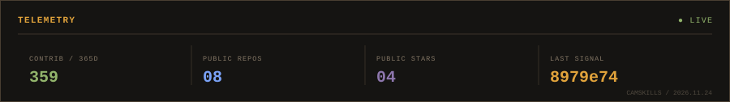
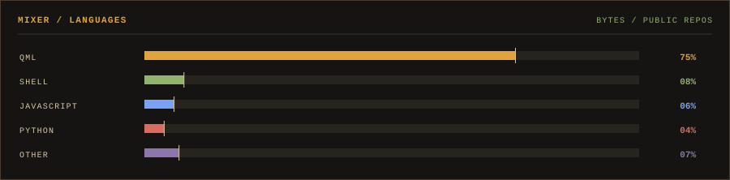

# CAM / 07

`LITTLE ENGINEER`<br>
**BUILDING THINGS THAT SHOULDN'T WORK.**

`linux / niri / obsidian / field notes / university / music`



---

## DECK / NOW

### [camskills](https://github.com/caml07/camskills)

skills de opencode que encuentro util para mobile, cosas de toda la vida etc. En general, las que utilize durante la pasantia y ahora en mi flujo de desarrollo diario

`JAVASCRIPT` · `ORIGINAL` · `★ 1`

**LAST SIGNAL**<br>
[`8979e74`](https://github.com/caml07/camskills/commit/8979e74ef097775078f3356cf7472b811755bea4) · `2026.11.24` · `09:51`<br>
Support the Windows installer from PowerShell and CMD

---

## GARDEN / 365D


<sub>365 contribution days → weekly stems → daily leaves. Same activity, same garden.</sub>

---

## BANK / PUBLIC

`▌ ● 01` **[camskills](https://github.com/caml07/camskills)** `JAVASCRIPT / NOW`
<sub>skills de opencode que encuentro util para mobile, cosas de toda la vida etc. En general, las que utilize durante la pasantia y ahora en mi flujo de desarrollo diario</sub>

`  ○ 02` **[FixIt](https://github.com/caml07/FixIt)** `— / PUBLIC`
<sub>Proyecto academico de Web Development II y Cloud Computing: mesa de ayuda y tickets IT</sub>

`  ○ 03` **[solana-library](https://github.com/caml07/solana-library)** `TYPESCRIPT / PUBLIC`
<sub>Biblioteca descentralizada en Solana: préstamos de libros con Rust, Anchor y React</sub>

`  ○ 04` **[iNiR](https://github.com/caml07/iNiR)** `QML / FORK`
<sub>A Niri shell illogical-impulse based - with some modifications..</sub>

`  ○ 05` **[OSF-Atlas](https://github.com/caml07/OSF-Atlas)** `PYTHON / PUBLIC`
<sub>An evidence-first archive of Obsidian Soundfields: transcripts, entities, locations and human-reviewed connections.</sub>

`  ○ 06` **[calc-slang-for-calculator-](https://github.com/caml07/calc-slang-for-calculator-)** `PYTHON / PUBLIC`
<sub>Una calculadora hecha con flask</sub>

`  ○ 07` **[wayvibes-tui](https://github.com/caml07/wayvibes-tui)** `RUST / PUBLIC`
<sub>A native Linux terminal interface for WayVibes, built with Rust, Ratatui and Crossterm.</sub>

`  ○ 08` **[spicetify-cat-jam-synced](https://github.com/caml07/spicetify-cat-jam-synced)** `TYPESCRIPT / FORK`
<sub>A spicetify extension that lets a cat jam in sync with the beat of your music. UPDATED</sub>

---

## MIXER / LANGUAGES



---

## LOG / RECENT

```text
2026.11.24 09:51  8979e74  camskills
  Support the Windows installer from PowerShell and CMD

2026.11.22 22:35  2d28a97  solana-library
  docs: record WayLearn submission and credit Cam Route

2026.11.22 22:21  0e6e097  solana-library
  docs: align Solana Library scope with delivered Devnet MVP

2026.11.22 22:13  1be1ea6  solana-library
  docs(evidence): publish 26 Devnet screenshots and README gallery

2026.11.22 21:08  b94db4b  solana-library
  docs(devnet): add Phantom verification checklist

2026.11.22 21:08  d8a6d01  solana-library
  design(web): add cacao and lime book favicon

2026.11.22 20:32  6d7c9ce  solana-library
  docs(devnet): publish live Explorer evidence and verified catalog
```

---

## LOCAL / OFF—REPO

`HOST` &nbsp;&nbsp;&nbsp;&nbsp;&nbsp; linux / niri<br>
`NOTES` &nbsp;&nbsp;&nbsp;&nbsp; obsidian / field notes<br>
`STATUS` &nbsp;&nbsp;&nbsp; university / computer science<br>
`AUDIO` &nbsp;&nbsp;&nbsp;&nbsp; usually something sad<br>
`MISC` &nbsp;&nbsp;&nbsp;&nbsp;&nbsp; things that should probably not work

---

<sub>SOURCE / GITHUB GRAPHQL + REST · REFRESH / 6H · UPDATED / 2026.11.24 · CAM / 07</sub>
