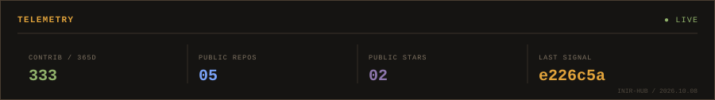
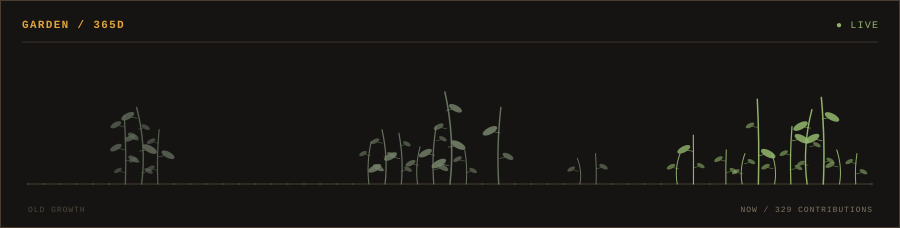
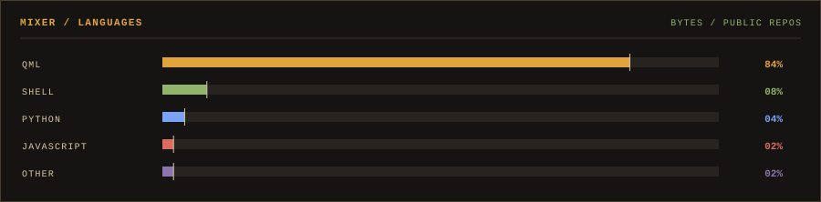

# CAM / 07

`LITTLE ENGINEER`<br>
**BUILDING THINGS THAT SHOULDN'T WORK.**

`linux / niri / obsidian / field notes / university / music`



---

## DECK / NOW

### [inir-hub](https://github.com/caml07?tab=repositories)

latest public work.

`NO PRIMARY LANGUAGE` · `ORIGINAL` · `★ 0`

**LAST SIGNAL**<br>
[`e226c5a`](https://github.com/snowarch/inir-hub/commit/e226c5a870245af6b61a015c7526e78585710574) · `2026.10.08` · `10:31`<br>
feat(void): first-class Void Linux support (#283)

---

## GARDEN / 365D



<sub>365 contribution days → weekly stems → daily leaves. Same activity, same garden.</sub>

---

## BANK / PUBLIC

`  ○ 01` **[iNiR](https://github.com/caml07/iNiR)** `QML / FORK`
<sub>A Niri shell illogical-impulse based - with some modifications..</sub>

`  ○ 02` **[OSF-Atlas](https://github.com/caml07/OSF-Atlas)** `PYTHON / PUBLIC`
<sub>An evidence-first archive of Obsidian Soundfields: transcripts, entities, locations and human-reviewed connections.</sub>

`  ○ 03` **[calc-slang-for-calculator-](https://github.com/caml07/calc-slang-for-calculator-)** `PYTHON / PUBLIC`
<sub>Una calculadora hecha con flask</sub>

`  ○ 04` **[wayvibes-tui](https://github.com/caml07/wayvibes-tui)** `RUST / PUBLIC`
<sub>A native Linux terminal interface for WayVibes, built with Rust, Ratatui and Crossterm.</sub>

`  ○ 05` **[spicetify-cat-jam-synced](https://github.com/caml07/spicetify-cat-jam-synced)** `TYPESCRIPT / FORK`
<sub>A spicetify extension that lets a cat jam in sync with the beat of your music. UPDATED</sub>

---

## MIXER / LANGUAGES



---

## LOG / RECENT

```text
2026.10.08 10:31  e226c5a  inir-hub
  feat(void): first-class Void Linux support (#283)

2026.10.08 10:31  3ed818d  inir-hub
  feat(void): first-class Void Linux support (#283)

2026.10.08 10:31  5ca6a79  inir-hub
  feat(void): first-class Void Linux support (#283)

2026.10.08 10:31  7e3f2df  iNiR
  feat(void): first-class Void Linux support (#283)

2026.10.01 14:30  4e2aae8  iNiR
  fix(recording): recenter OSD until drag

2026.10.01 14:30  1e7e0ce  iNiR
  fix(recording): keep the OSD on every output

2026.09.27 10:15  2cc1b77  OSF-Atlas
  data: complete OSF corpus 111-125
```

---

## LOCAL / OFF—REPO

`HOST` &nbsp;&nbsp;&nbsp;&nbsp;&nbsp; linux / niri<br>
`NOTES` &nbsp;&nbsp;&nbsp;&nbsp; obsidian / field notes<br>
`STATUS` &nbsp;&nbsp;&nbsp; university / computer science<br>
`AUDIO` &nbsp;&nbsp;&nbsp;&nbsp; usually something sad<br>
`MISC` &nbsp;&nbsp;&nbsp;&nbsp;&nbsp; things that should probably not work

---

<sub>SOURCE / GITHUB GRAPHQL + REST · REFRESH / 6H · UPDATED / 2026.10.30 · CAM / 07</sub>
