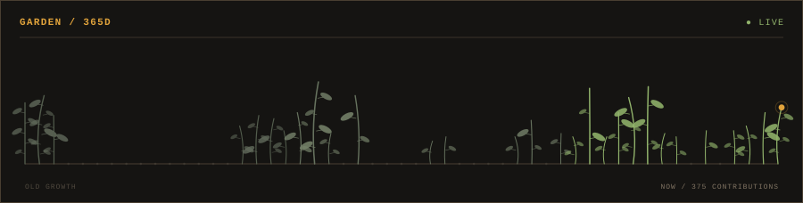

# CAM / 07

`LITTLE ENGINEER`<br>
**BUILDING THINGS THAT SHOULDN'T WORK.**

`linux / niri / obsidian / field notes / university / music`


---

## DECK / NOW

### [FixIt](https://github.com/caml07/FixIt)

Proyecto academico de Web Development II y Cloud Computing: mesa de ayuda y tickets IT

`NO PRIMARY LANGUAGE` · `ORIGINAL` · `★ 0`

**LAST SIGNAL**<br>
[`b6803e2`](https://github.com/caml07/FixIt/commit/b6803e2bb23c1ef330fa6e4e0825770d64460833) · `2026.11.09` · `22:18`<br>
chore: inicializar repositorio vacío

---

## GARDEN / 365D



<sub>365 contribution days → weekly stems → daily leaves. Same activity, same garden.</sub>

---

## BANK / PUBLIC

`▌ ● 01` **[FixIt](https://github.com/caml07/FixIt)** `— / NOW`
<sub>Proyecto academico de Web Development II y Cloud Computing: mesa de ayuda y tickets IT</sub>

`  ○ 02` **[camskills](https://github.com/caml07/camskills)** `JAVASCRIPT / PUBLIC`
<sub>skills de opencode que encuentro util para mobile, cosas de toda la vida etc. En general, las que utilize durante la pasantia y ahora en mi flujo de desarrollo diario</sub>

`  ○ 03` **[iNiR](https://github.com/caml07/iNiR)** `QML / FORK`
<sub>A Niri shell illogical-impulse based - with some modifications..</sub>

`  ○ 04` **[OSF-Atlas](https://github.com/caml07/OSF-Atlas)** `PYTHON / PUBLIC`
<sub>An evidence-first archive of Obsidian Soundfields: transcripts, entities, locations and human-reviewed connections.</sub>

`  ○ 05` **[calc-slang-for-calculator-](https://github.com/caml07/calc-slang-for-calculator-)** `PYTHON / PUBLIC`
<sub>Una calculadora hecha con flask</sub>

`  ○ 06` **[wayvibes-tui](https://github.com/caml07/wayvibes-tui)** `RUST / PUBLIC`
<sub>A native Linux terminal interface for WayVibes, built with Rust, Ratatui and Crossterm.</sub>

`  ○ 07` **[spicetify-cat-jam-synced](https://github.com/caml07/spicetify-cat-jam-synced)** `TYPESCRIPT / FORK`
<sub>A spicetify extension that lets a cat jam in sync with the beat of your music. UPDATED</sub>

---

## MIXER / LANGUAGES


---

## LOG / RECENT

```text
2026.11.09 22:18  b6803e2  FixIt
  chore: inicializar repositorio vacío

2026.11.09 13:09  24f9c85  camskills
  feat: rediseñar instalador y documentación de CamSkills

2026.11.09 12:07  d3591f6  camskills
  feat: integrar Pstack y cam-route al workflow de skills

2026.10.24 23:29  a70c685  camskills
  feat: add stable Matt Pocock skills

2026.10.24 23:19  f7fefc0  camskills
  sync: refresh local skills and curate impeccable RN from upstream

2026.10.24 23:11  3f6ef96  camskills
  docs: add retrospective course review guidance

2026.10.24 23:11  460194c  camskills
  fix: migrate local OpenCode plugins and staged-secret scanner to V2
```

---

## LOCAL / OFF—REPO

`HOST` &nbsp;&nbsp;&nbsp;&nbsp;&nbsp; linux / niri<br>
`NOTES` &nbsp;&nbsp;&nbsp;&nbsp; obsidian / field notes<br>
`STATUS` &nbsp;&nbsp;&nbsp; university / computer science<br>
`AUDIO` &nbsp;&nbsp;&nbsp;&nbsp; usually something sad<br>
`MISC` &nbsp;&nbsp;&nbsp;&nbsp;&nbsp; things that should probably not work

---

<sub>SOURCE / GITHUB GRAPHQL + REST · REFRESH / 6H · UPDATED / 2026.11.22 · CAM / 07</sub>
